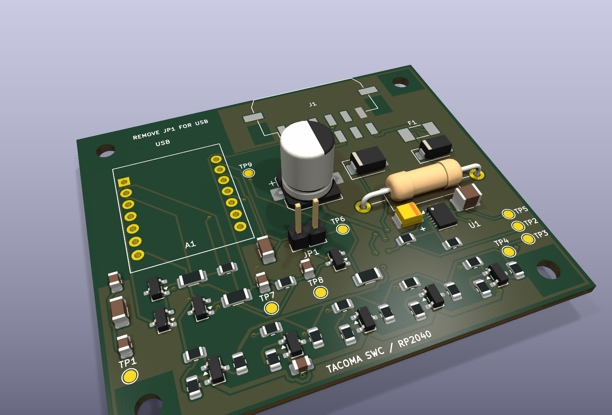
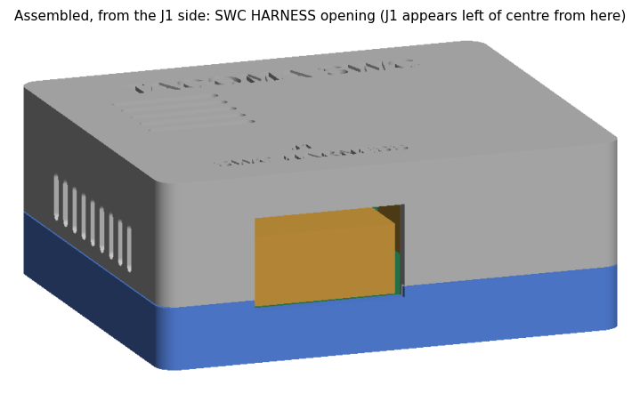
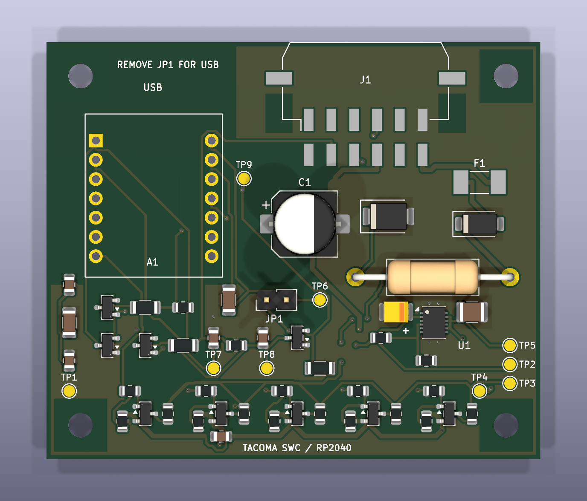

# Gen 2 Tacoma → Continental steering-wheel controls

A small board that lets the steering-wheel audio buttons of a **second-generation Toyota Tacoma** (2005–2015) control a **Continental CRD4512UBA** aftermarket radio.

The Tacoma's wheel buttons and the Continental's steering-wheel input both work by resistance, but they don't speak the same language. The truck puts its seven buttons on two separate resistor ladders. The radio expects one resistance on one wire, with its own set of values. This board reads the truck's two lines, works out which button is pressed, and switches in the resistance the radio wants for that command.

*3D render. J1, the XIAO module and its sockets have no 3D models, so their footprints appear empty.*

## How it works

- **Inputs.** Each wheel line (SW1, SW2) is pulled up to 3.3 V through 2.2 kΩ. Pressing a button connects a resistor from the line to ground, and the voltage drops by a predictable amount. The XIAO RP2040 reads both lines with its 12-bit ADC about every 2 ms.
- **Decoding.** Each reading falls into a band: released, or one of the buttons. Readings between bands, or both lines active at once, are treated as invalid and the output is released. A press has to hold steady for 20 ms before it counts.
- **Outputs.** Five resistors (47 Ω, 191 Ω, 390 Ω, 1 kΩ, 2 kΩ) sit between the radio's SWRC+ and SWRC GND, each switched by its own MOSFET. Five of the seven commands use one resistor; Volume + and Seek + use two in parallel, switched on together in a single register write. While you hold a button, the board holds the resistance; the radio handles its own repeat.
- **Power.** The board runs from the truck's switched 12 V ACC through a fuse, a reverse-polarity diode, a 10 Ω resistor, a TVS diode and an LT3012 regulator set to 5 V. It draws about 25 mA. The radio supplies its own sense voltage, so the board never drives the radio input; it only presents a resistance.
- **Fail-safe.** Gate pull-downs hold every output off through reset or with the XIAO unplugged. A 1-second watchdog restarts a stalled loop, and a press held longer than 10 seconds is released.

| Wheel button | Line | Radio command | Board output |
|---|---|---|---:|
| Seek + | SW1 | Seek Up | 390 Ω ‖ 1 kΩ = 281 Ω |
| Seek − | SW1 | Seek Down | 390 Ω |
| Volume + | SW1 | Volume Up | 191 Ω ‖ 390 Ω = 128 Ω |
| Volume − | SW1 | Volume Down | 47 Ω |
| Mode | SW2 | Source | 191 Ω |
| Answer (off-hook) | SW2 | Phone (answers, or ends an active call) | 1 kΩ |
| Hang Up (on-hook) | SW2 | Mic Mute | 2 kΩ |

The radio's Phone command toggles with the call state, so Answer covers both answering and hanging up. That frees the Hang Up button for Mic Mute. The radio has a Preset command (470–720 Ω) that isn't mapped to any button.

The wheel resistances, the radio's measured recognition windows and the harness wiring are in [docs/interface.md](docs/interface.md).

## Status

**Built and working on the bench.** Two boards were made with factory assembly. On a powered CRD4512UBA, every command acted once per press: Volume Up/Down, Source, Seek Up/Down, Mic Mute (toggled on and off during a call), and Phone (ended a connected call). Powered from 12 V ACC, the board draws 25 mA and the regulator stays cool.

The ADC bands for the wheel buttons come from the Toyota service-manual resistances and circuit simulation, not from readings on the truck. If a button misbehaves in your truck, send `status` over USB while holding it, and compare the count with the bands in [firmware/README.md](firmware/README.md).

Tested with a 2013 Tacoma. The wheel resistances are documented for 2011–2015 trucks; earlier Gen 2 trucks with audio buttons probably match, but measure them first.

## Building one

1. **Order the assembled board.** The regulator (LT3012, 3 × 4 mm DFN) and most of the parts are surface-mount, so a PCB assembly service is the practical route. Upload [`hardware/fab/tacoma_swc_gerbers.zip`](hardware/fab/tacoma_swc_gerbers.zip), [`BOM.csv`](hardware/fab/BOM.csv) and [`smt-placement.csv`](hardware/fab/assembly/smt-placement.csv). See the [ordering notes](hardware/fab/ORDERING.md).
2. **Get a XIAO RP2040** (the standard one, not the Plus) with its 1 × 7 male headers soldered on. It plugs into two sockets on the carrier.
3. **Load the firmware.** Pull the **JP1** shunt first, then hold the XIAO's BOOT button while plugging in USB and copy a UF2 file onto the drive that appears: [`tacoma-swc-bench.uf2`](firmware/releases/tacoma-swc-bench.uf2) to test from a computer, or [`tacoma-swc-vehicle.uf2`](firmware/releases/tacoma-swc-vehicle.uf2) for the truck. Details in [firmware/README.md](firmware/README.md).
4. **Test on the bench (optional).** With the bench build, USB serial commands like `volume_up` pulse the matching output for 300 ms. Connect J1 pin 9 (SWRC+) and pin 10 (SWRC GND) to the radio and check each one.
5. **Print the case** (PETG or ASA) from [`hardware/enclosure/`](hardware/enclosure/): two parts, no supports, 4 × M3 × 12 screws, no nuts.

   

6. **Install.** Load the vehicle build, **refit JP1**, plug the harness into J1, and set the radio's SWRC type to *Resistance*.

## Wiring

J1 is a Molex Micro-Fit 3.0, 2 × 6 right-angle header (43045-1209). It mates with the 12-pin harness of an Axxess AXSWC steering-wheel interface, so the board can take the AXSWC's place. You don't need the AXSWC module itself, only its harness:

- **Likely alternative (untested):** the [RED WOLF 20-pin steering-wheel control harness w/RCA](https://www.amazon.com/RED-WOLF-Replacement-2003-2014-Aftermarket/dp/B09S33B8L1). It's sold separately as a replacement for the AXSWC/ASWC-1 harness. Before plugging it in, check two things:
  - its module-end plug is the 12-pin Micro-Fit;
  - its wiring matches the [J1 pinout](#wiring) below, especially ACC (pin 12), SWRC+ (pin 9) and SWRC GND (pin 10). Check this with a meter.
- **Make your own:** a Molex 43025-1200 housing and Micro-Fit crimp terminals.

| J1 pin | Signal | Goes to |
|---:|---|---|
| 4 | SW1 | Tacoma radio connector R15-21 (wheel ladder 1) |
| 8 | SW2 | Tacoma R15-22 (wheel ladder 2) |
| 6 | GND | Vehicle ground, tied to the wheel's SWG (R15-23) |
| 12 | ACC | Switched 12 V |
| 9 | SWRC+ | Radio steering-wheel input, 3.5 mm plug tip (red) |
| 10 | SWRC GND | Radio steering-wheel ground (white) |
| others | — | Not connected |

Test points: TP1 GND, TP2 5 V regulator output, TP3 SWRC+, TP4 SWRC GND, TP5 ACC after protection, TP6 XIAO 5 V, TP7/TP8 SW1/SW2 at the ADC, TP9 3.3 V.

## Safety notes

- **Pull JP1 before plugging in USB.** The XIAO's 5 V pin is wired straight to its USB VBUS. With JP1 fitted, the board's regulator and the computer's USB port would be connected together. The silkscreen says so too.
- Don't measure the board's output resistance with an ohmmeter while the radio is connected and powered. Watch what the radio does instead.
- The power input is fused, reverse-protected and clamped (24 V TVS), but it hasn't been qualified against automotive load-dump or jump-start tests.
- Don't wrap the case in harness tape; leave the vented side and the top open.

## Repository layout

| Path | What |
|---|---|
| [`hardware/`](hardware/) | KiCad 10 project, design checks, SPICE simulation and the generator scripts. [Design notes](hardware/README.md). |
| [`hardware/fab/`](hardware/fab/) | Gerbers, BOM, placement files, assembly drawings, [ordering notes](hardware/fab/ORDERING.md) |
| [`hardware/enclosure/`](hardware/enclosure/) | Case STLs and STEP, plus the FreeCAD generator script |
| [`firmware/`](firmware/) | RP2040 firmware (PlatformIO + Arduino-Pico), prebuilt UF2 files, host tests |
| [`docs/interface.md`](docs/interface.md) | The Tacoma wheel ladders, the Continental input, and the harness |

## License

- **Hardware** (everything under `hardware/` except the Python scripts: schematic, PCB, Gerbers, BOM, case models): [CERN-OHL-S-2.0](LICENSE-HARDWARE).
- **Firmware, scripts and tools:** [GPL-3.0](LICENSE).
- **Documentation:** follows the hardware or software it describes.

## Credits

- Steering-wheel resistances from the 2011–2015 Tacoma service manual (Steering Pad Switch Circuit).
- The XIAO socket footprint follows Seeed Studio's [KiCad library](https://github.com/Seeed-Studio/OPL_Kicad_Library).
- Built with KiCad, Freerouting, ngspice, FreeCAD, PlatformIO and the [Arduino-Pico](https://github.com/earlephilhower/arduino-pico) core.

Toyota and Tacoma are trademarks of Toyota Motor Corporation. Continental is a trademark of its owner. Axxess is a trademark of Metra Electronics. XIAO is a trademark of Seeed Technology. This project isn't affiliated with or endorsed by any of them.
