# The two interfaces

The electrical interfaces on each side of the board: the truck's steering-wheel lines, the radio's SWRC input, and the harness between them. Each section gives the source of its numbers.

## Tacoma steering wheel

The wheel's audio buttons are passive: switches and resistors, wired through the spiral cable to the radio connector with no electronics in between. There are two ladders, each read against a shared return (SWG).

| Radio connector pin | Signal | Wheel connector |
|---|---|---|
| R15-21 | SW1 (AU1) | z1-10 |
| R15-22 | SW2 (AU2) | z1-9 |
| R15-23 | SWG (EAU) | z1-8 |

Resistance from each line to SWG, with the radio disconnected:

| Line | Button | Published range | Board reads it as (12-bit ADC) |
|---|---|---|---|
| SW1 | Seek + | < 2.5 Ω | 0–60 |
| SW1 | Seek − | 313–345 Ω | 340–630 |
| SW1 | Volume + | 950–1050 Ω | 930–1390 |
| SW1 | Volume − | 2955–3265 Ω | 1830–2530 |
| SW2 | Mode | < 2.5 Ω | 0–60 |
| SW2 | Hang Up (on-hook) | 313–345 Ω | 340–630 |
| SW2 | Answer (off-hook) | 950–1050 Ω | 930–1390 |
| SW2 | Voice (not on all wheels) | 2955–3265 Ω | ignored |
| either | Released | 95–105 kΩ | 3160–4095 |

Source: the 2011–2015 Tacoma repair manual, *Steering Pad Switch Circuit* (navigation and audio system diagnostics). The later (2016+) Tacoma manual lists tighter tolerances for the same buttons; don't use those for a Gen 2 truck.

The factory navigation receiver pulls these lines up to about 3.3 V (its manual lists 2.97–3.56 V idle). The board does the same: 3.3 V through a BAS70 diode and 2.2 kΩ. The ADC bands allow for:

- ±1 % pull-up resistors
- a 3.2–3.4 V supply
- 0–0.6 V across the blocking diode
- ±32 counts of extra ADC error

The gaps between bands are deliberate. A reading that lands in a gap releases the output instead of guessing.

A short to ground on a line looks exactly like Seek + or Mode. The firmware can't tell them apart, but it releases after 10 seconds of continuous press.

## Continental CRD4512UBA

The radio's steering-wheel input is a 3.5 mm jack: tip is SWRC+, and SWRC GND is the return. Set **SWRC TYPE = Resistance** in the radio's menu. (Some related Continental models also have a PWM mode on another pin; this board doesn't use it.)

Measured on the radio:
- **Open circuit:** SWRC+ sits at 3.3 V.
- **With 470 Ω to SWRC GND:** it reads 1.63 V. That points to an internal pull-up of about 470 Ω to 3.3 V.
- **SWRC GND:** measures 0 Ω to the radio's main power ground.

The radio doesn't learn resistances; it has fixed windows. They were found by sweeping a 10-turn potentiometer across the input (boundaries ±10 Ω or so at the low end):

| Resistance | Command | Board output |
|---|---|---:|
| 0–100 Ω | Volume Down | 47 Ω |
| 100–160 Ω | Volume Up | 191 ‖ 390 = 128 Ω |
| 160–220 Ω | Source | 191 Ω |
| 220–320 Ω | Seek Up | 390 ‖ 1000 = 281 Ω |
| 320–470 Ω | Seek Down | 390 Ω |
| 470–720 Ω | Preset | not used |
| 720 Ω–1.3 kΩ | Phone | 1 kΩ |
| 1.3–3.0 kΩ | Mic Mute | 2 kΩ |
| above ~3 kΩ | nothing | released |

Each output sits well inside its window. MOSFET on-resistance (under 50 mΩ) and trace resistance don't move any of them noticeably.

**Phone** depends on the call state: it answers a ringing call and ends an active one. So the wheel's Answer button maps to Phone, and Hang Up is free for Mic Mute.

**Changing commands:** the firmware always switches every branch off, waits 20 µs, then switches on the full new set in one register write. That way the radio never sees a stray intermediate resistance. C11 (10 nF across SWRC+/SWRC GND) softens the switching edges. Simulation of all 56 command-to-command changes shows the input settling into the right window within 178 µs.

## Harness

The board plugs into the 12-pin Molex Micro-Fit 3.0 harness made for an Axxess AXSWC interface. The pin assignments were traced by continuity on that harness.

The [RED WOLF 20-pin SWC harness](https://www.amazon.com/RED-WOLF-Replacement-2003-2014-Aftermarket/dp/B09S33B8L1) is sold as a replacement harness for the AXSWC/ASWC-1, so it has the same plug and pinout. It hasn't been tried with this board yet.

Pin assignments:

| Molex pin | Signal | Notes |
|---:|---|---|
| 4 | SW1 | |
| 8 | SW2 | |
| 6 | GND | Already tied to the wheel's SWG inside the harness |
| 12 | ACC | Switched 12 V |
| 9 | SWRC+ | Red wire, to the radio's 3.5 mm plug tip |
| 10 | SWRC GND | White wire |
| 11 | — | A wire to Toyota cavity 24, which has no function on this truck; left unconnected |
| 1, 2, 3, 5, 7 | — | Empty |

On the board, NT1 bonds SWRC GND to the main ground, so the radio's input return and the wheel's return share a reference.

